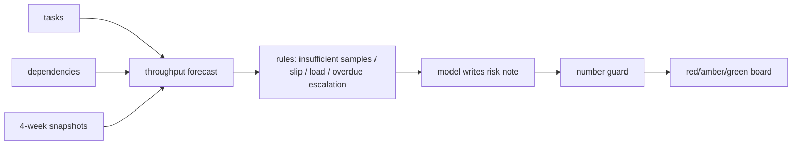

# Amber · project risk

[](https://github.com/wushiyi105-jpg/amber/actions)

[](./LICENSE)


Which task is likely to slip, flagged before the deadline.

## Features

- Forecasts completion from the mean throughput of the last four weeks; fewer than three snapshots means no forecast.
- Checks load for the next two weeks (1 point = 4 hours) and warns above 120%.
- Runs a depth-first search over dependencies and refuses to produce a board when a cycle exists.
- Escalates tasks overdue by three days into the red column.

Rules live in `amber/domain/rules/`; the CLI and the web layer only call them. The Chinese README lists every `rule_id` with its penalty.

## Quickstart

```bash
pip install -e ".[dev]"
python -m amber seed
python -m amber board --day 2026-11-27
python -m amber explain --day 2026-11-27
python -m amber serve        # http://127.0.0.1:8005
```

Run `python -m amber --help` for the full command list; `docker build -t amber . && docker run -p 8005:8005 amber` works the same way.

## Why not just ask a general LLM

The status field in a board is self-reported and usually optimistic. Amber only uses throughput and remaining points, so nobody has to keep the board tidy for the forecast to be right.

## When to use it

- A small team has no PM but still needs a weekly risk call.
- You need to confirm dependencies are acyclic before trusting any date.

## Roadmap

- Read task snapshots from Jira / Linear.
- Compute load per person rather than per team.

## FAQ

**How accurate is the forecast?**
It is a throughput average; with fewer than three snapshots it says “not enough samples”.

**What happens on a dependency cycle?**
It raises an error and produces no board.

**Was the Docker image verified?**
Docker is not installed on the build machine, so `docker build .` was not run and the image is unverified; only the Dockerfile and ports were checked statically.

## Commands

See the Chinese README (`README.md`) for the command table with flags; every command supports `--help`.

## Dependencies

FastAPI + Uvicorn, Jinja2, pydantic / pydantic-settings, httpx, Typer + Rich, SQLAlchemy + Alembic; dev extras add pytest, pytest-cov, respx, freezegun, ruff, mypy, pip-audit. Version pinning lives in `uv.lock`.

## How it works



## Layout

```
amber/
├── .github/
│   ├── ISSUE_TEMPLATE
│   ├── PULL_REQUEST_TEMPLATE.md
│   └── workflows
├── amber/
│   └── … 9 项
├── assets/
│   └── demo.gif
├── data/
│   ├── amber.db
│   └── seed.json
├── migrations/
│   ├── __init__.py
│   ├── env.py
│   ├── script.py.mako
│   └── versions
├── prompts/
│   └── explain.md
├── templates/
│   └── index.html
├── tests/
│   ├── __init__.py
│   ├── conftest.py
│   ├── test_board_guard.py
│   ├── test_load_deps.py
│   ├── test_throughput_forecast.py
│   └── test_web_cli.py
├── CHANGELOG.md
├── CODE_OF_CONDUCT.md
├── CONTRIBUTING.md
├── Dockerfile
├── LICENSE
├── README.en.md
├── README.md
├── SECURITY.md
├── alembic.ini
├── pyproject.toml
```

## Author

Dazhao · GitHub [@wushiyi105-jpg](https://github.com/wushiyi105-jpg) · 17382987315
