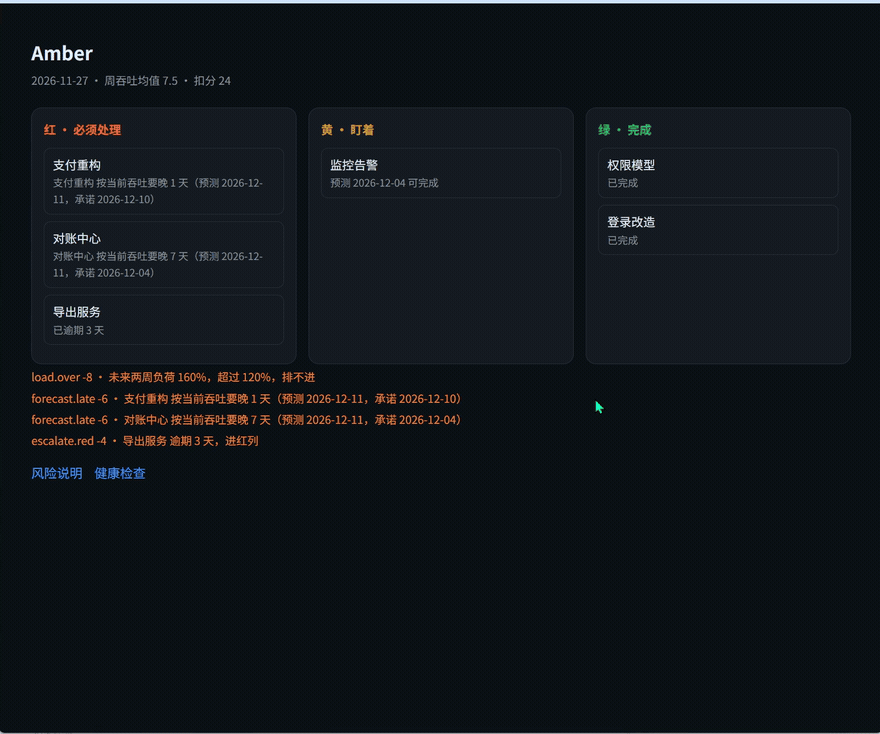

# Amber

[](https://github.com/wushiyi105-jpg/amber/actions)



Which work will slip, flagged before it slips.

## What it does

- forecasts completion from the last four weekly throughput snapshots;
- checks the next two weeks' load against capacity, red above 120%;
- refuses to render a board when dependencies form a cycle;
- escalates anything overdue by three days;
- lets the model explain, but never invent dates or points.

## Run

```bash
pip install -e ".[dev]"
python -m amber seed
python -m amber board --day 2026-11-27
python -m amber serve
```

## Author

shiyi · GitHub [@wushiyi105-jpg](https://github.com/wushiyi105-jpg) · wushiyi105@gmail.com
