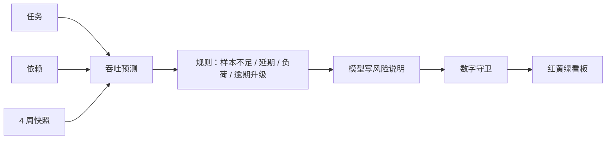

# Amber · 项目风险

[](https://github.com/wushiyi105-jpg/amber/actions)

[](./LICENSE)


哪件事大概率延期，提前标出来。


## 功能特性

1. **吞吐预测**：最近 4 周完成点数取均值，剩余点数除一下得到周数；少于 3 周快照不预测。
2. **负荷检测**：未来两周任务点数（1 点 = 4 小时）除以可用工时，超 120% 报警。
3. **依赖成环**：深度优先找环，找到就抛错。
4. **逾期升级**：逾期 3 天进红列。
5. **风险说明**：模型只解释，日期与点数必须来自输入。

### 规则与扣分

| rule_id | 含义 | 扣分 |
| --- | --- | --- |
| `throughput.no_sample` | 快照少于 3 周，不预测 | 0 |
| `forecast.late` | 预测完工日晚于承诺日 | 6 |
| `load.over` | 未来两周负荷 > 120% | 8 |
| `escalate.red` | 逾期 ≥ 3 天进红列 | 4 |
| `guard.number` | 说明里出现输入外数字，整行丢弃 | 8 |

## 快速开始

```bash
pip install -e ".[dev]"
python -m amber seed
python -m amber board --day 2026-11-27
python -m amber explain --day 2026-11-27
python -m amber serve        # http://127.0.0.1:8005
```

真实种子：6 个任务（41 点，已完成 32 点）、3 条依赖、4 周快照（9/7/8/6 点）。
`board --day 2026-11-27` 的结果：红 3（导出服务逾期 3 天、支付重构预测 12-11 晚 1 天、对账中心晚 7 天）、
黄 1、绿 2；未来两周 16 点折 64 小时 / 40 小时 = 160%，超 120% 报警；周吞吐均值 7.5 点。

## 为什么不用通用大模型直接问

状态是人填的，填的时候往往还乐观。Amber 只用历史吞吐和剩余点数算完工日，再用未来两周的
任务量算负荷；两者都不需要谁每天去改状态。依赖成环直接报错不出报告，避免拿一张假看板做决策。

## 适用场景

- 小团队没有专职 PM，但想知道手上这几件事会不会延期。
- 每周例会上要给出「哪几件进红列」的结论，而不是各说各话。
- 任务之间有依赖，想先确认没成环再算日期。

### 边界

- 不取代 Jira，只读任务快照；
- 不做人力排班（那是 Rota 的事）；
- 预测依赖历史吞吐，团队规模突变时先补快照。

## Roadmap

- 读 Jira / Linear 的任务快照，省掉手工导入。
- 按人算负荷，而不只是团队总量。
- 延期原因分类，便于复盘。

## FAQ

**预测准吗？**
用最近 4 周完成点数的均值推，快照少于 3 周不预测，直接标「样本不足」。

**依赖成环会怎样？**
抛错，不出报告，避免拿一张假看板做决策。

**状态要每天改吗？**
不用，预测只看点数与快照。

## 命令参考

| 命令 | 作用 | 常用参数 |
| --- | --- | --- |
| `seed` | 写入任务、依赖与 4 周快照。 | --db |
| `board` | 看板三列与扣分。 | --day, --db |
| `explain` | 模型说明（无 key 走本地事实）。 | --day, --db |
| `jobs` | 每日重算任务。 | --day, --run, --db |
| `doctor` | 四项体检。 | --db |
| `serve` | Web 界面。 | --port, --db |

全部命令都支持 `--help`；只读命令不带参数时读默认库 `data/amber.db`，写命令用 `--db` 指到别的库。

## 依赖说明

| 依赖 | 为什么装 | 不装会怎样 |
| --- | --- | --- |
| `fastapi` + `uvicorn[standard]` | Web 入口与 ASGI 服务 | 只有命令行，没有页面 |
| `jinja2` | 服务端渲染模板 | 页面出不来 |
| `pydantic` + `pydantic-settings` | 配置与数据结构校验，`.env` 直接生效 | 配置散在代码里，改端口要改源码 |
| `httpx` | 调模型与 webhook 的 HTTP 客户端 | 模型层与推送都不可用 |
| `typer` + `rich` | 命令行与终端表格 | 只能用 curl 调接口 |
| `sqlalchemy` + `alembic` | 本地库与迁移 | 表结构变更只能删库重来 |
| `pytest` / `pytest-cov` / `respx` / `freezegun`（dev） | 单测、覆盖率、HTTP 打桩、冻结时间 | 规则改动没有回归保护 |
| `ruff` / `mypy` / `pip-audit`（dev） | 风格、类型、依赖漏洞检查 | CI 只看测试，类型错误会漏进主干 |

装了 `uv` 的话，`uv sync --extra dev` 会按 `uv.lock` 装同一套版本。

## 工作原理




domain 里是吞吐预测、负荷、成环与升级；app 负责看板三列。

## 目录结构

```
amber/
├── .github/
│   ├── ISSUE_TEMPLATE
│   ├── PULL_REQUEST_TEMPLATE.md
│   └── workflows
├── amber/
│   └── … 9 项
├── assets/
│   └── demo.gif
├── data/
│   ├── amber.db
│   └── seed.json
├── migrations/
│   ├── __init__.py
│   ├── env.py
│   ├── script.py.mako
│   └── versions
├── prompts/
│   └── explain.md
├── templates/
│   └── index.html
├── tests/
│   ├── __init__.py
│   ├── conftest.py
│   ├── test_board_guard.py
│   ├── test_load_deps.py
│   ├── test_throughput_forecast.py
│   └── test_web_cli.py
├── CHANGELOG.md
├── CODE_OF_CONDUCT.md
├── CONTRIBUTING.md
├── Dockerfile
├── LICENSE
├── README.en.md
├── README.md
├── SECURITY.md
├── alembic.ini
├── pyproject.toml
```

## 作者

shiyi · GitHub [@wushiyi105-jpg](https://github.com/wushiyi105-jpg) · wushiyi105@gmail.com
