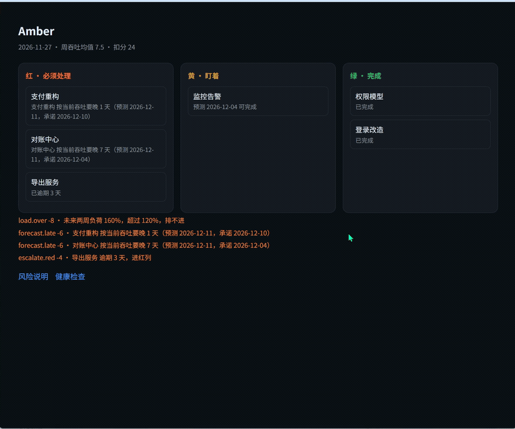

# Amber · 项目风险

[](https://github.com/wushiyi105-jpg/amber/actions)

[](./LICENSE)



哪件事大概率延期，提前标出来。

## 为什么不是看板软件里那个「状态」

状态是人填的，填的时候往往还乐观。Amber 只用历史吞吐和剩余点数算完工日，再用未来两周的
任务量算负荷；两者都不需要谁每天去改状态。依赖成环直接报错不出报告，避免拿一张假看板做决策。

## 它做什么

1. **吞吐预测**：最近 4 周完成点数取均值，剩余点数除一下得到周数；少于 3 周快照不预测。
2. **负荷检测**：未来两周任务点数（1 点 = 4 小时）除以可用工时，超 120% 报警。
3. **依赖成环**：深度优先找环，找到就抛错。
4. **逾期升级**：逾期 3 天进红列。
5. **风险说明**：模型只解释，日期与点数必须来自输入。

## 怎么用

```bash
pip install -e ".[dev]"
python -m amber seed
python -m amber board --day 2026-11-27
python -m amber explain --day 2026-11-27
python -m amber serve        # http://127.0.0.1:8005
```

真实种子：6 个任务（41 点，已完成 32 点）、3 条依赖、4 周快照（9/7/8/6 点）。
`board --day 2026-11-27` 的结果：红 3（导出服务逾期 3 天、支付重构预测 12-11 晚 1 天、对账中心晚 7 天）、
黄 1、绿 2；未来两周 16 点折 64 小时 / 40 小时 = 160%，超 120% 报警；周吞吐均值 7.5 点。

## 规则与扣分

| rule_id | 含义 | 扣分 |
| --- | --- | --- |
| `throughput.no_sample` | 快照少于 3 周，不预测 | 0 |
| `forecast.late` | 预测完工日晚于承诺日 | 6 |
| `load.over` | 未来两周负荷 > 120% | 8 |
| `escalate.red` | 逾期 ≥ 3 天进红列 | 4 |
| `guard.number` | 说明里出现输入外数字，整行丢弃 | 8 |

## 边界

- 不取代 Jira，只读任务快照；
- 不做人力排班（那是 Rota 的事）；
- 预测依赖历史吞吐，团队规模突变时先补快照。

## 作者

shiyi · GitHub [@wushiyi105-jpg](https://github.com/wushiyi105-jpg) · wushiyi105@gmail.com
